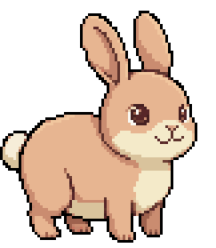
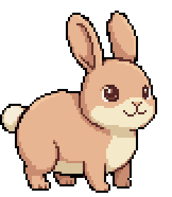

<p align="center">
  
</p>

<h1 align="center">Floater</h1>

<p align="center">A small pixel-art pet that lives on top of your windows.</p>

<p align="center">
  
</p>

Floater puts a little character on your desktop. It wanders along the bottom of the screen, notices your
cursor and chases it, gets sleepy and naps, and complains when you pick it up and throw it. It stays out of
your way: clicks go straight through to the windows underneath, except on the pet itself.

## Characters

### Croc

| idle | walk | run | chomp |
|:-:|:-:|:-:|:-:|
|  |  |  |  |
| **sleep** | **happy** | **picked up** | **eat** |
|  |  |  |  |

### Rabbit

| idle | walk | run | celebrate |
|:-:|:-:|:-:|:-:|
|  |  |  |  |
| **sleep** | **dizzy** | **eat** | **happy** |
|  |  |  |  |

## What it does

- **Lives on your desktop**: always on top, walks along the bottom of the screen, never blocks your clicks.
- **Reacts to you**: notices the cursor, chases it, and chomps when it catches it.
- **Pick it up**: drag it anywhere and let go to throw it. It falls, lands and gets dizzy.
- **Has needs**: gets tired, hungry and bored. Click it to pet it, feed it from the tray menu. It remembers
  across restarts.
- **Tray menu**: switch character, change size, feed, wake, toggle following the cursor.
- **Scriptable**: a local MCP server lets AI assistants make it walk, emote or go home.

## Install

> The first public release is on its way. Once it is out, these commands will work as written.

**Linux** (x86_64; GNOME, KDE and other X11 or Wayland desktops):

```sh
curl -fsSL https://raw.githubusercontent.com/been-there-done-that/floater-releases/main/install.sh | sh
```

This installs for your user only (no sudo) into `~/.local`: the `floater` command, the app icon, and the
app-menu entry. Then start **Floater** from your app grid, or run `floater`.

- Start on login: add `--autostart` (`... | sh -s -- --autostart`).
- A specific version: `... | sh -s -- --version v0.1.0`.
- Debian/Ubuntu package instead: download the `.deb` from [Releases](../../releases) and run
  `sudo apt install ./floater_*.deb`.

**GNOME on Wayland**: the installer also sets up a tiny GNOME Shell extension that lets the pet see your
cursor. Log out and back in once after the first install.

**Windows**: coming later.

## Update

Run the install command again, or use **Check for updates…** in the tray menu. Updates keep your settings.
To go back to an older version, install it with `--version`.

## Uninstall

```sh
curl -fsSL https://raw.githubusercontent.com/been-there-done-that/floater-releases/main/install.sh | sh -s -- --uninstall
```

Your settings in `~/.floater/` are kept; delete that folder too to remove everything.

## Verify a download

Every release has a `SHA256SUMS` file, signed with the project's minisign key. The installer checks both
before it installs anything and stops on any mismatch. To check by hand:

```sh
minisign -Vm SHA256SUMS -P <public key from this README>
sha256sum -c SHA256SUMS --ignore-missing
```

## Privacy

Floater runs entirely on your computer. It sends nothing anywhere. The MCP bridge listens only on
`127.0.0.1` and needs a token stored in your home folder.

## Feedback

Found a bug or have an idea? [Open an issue](../../issues).
